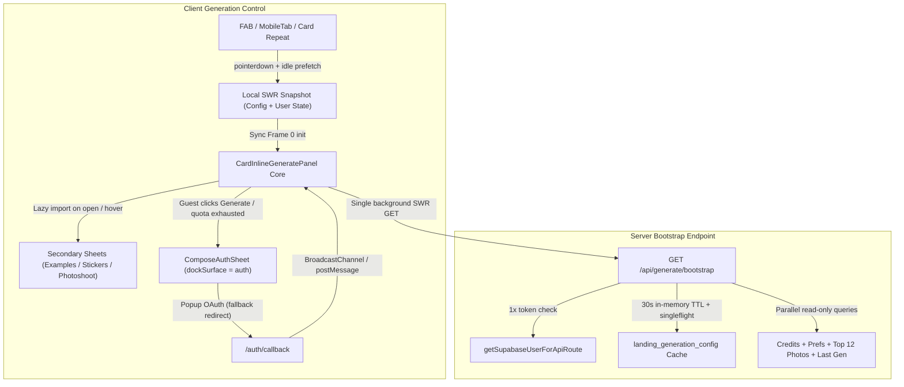

# Ускорение контрола генерации, стабилизация верстки и встроенная авторизация

> **Дата:** 2026-11-13  
> **Статус:** реализовано  
> **Ветка:** `cursor/generate-modal-perf-and-auth-6065`  
> **Роль:** `@high-scale-architect`  
> **Связано:** `docs/31-08-generate-dock-instant-compose.md`, `docs/architecture/01-landing.md`

---

## 1. Контекст и допущения

Работа над модулем генерации (`CardInlineGeneratePanel` + `GenerateListingDockHost`) разделена на два последовательных этапа:

1. **Этап 1 (текущая поставка):** устранение сетевых и рендер-блокеров для гостей и авторизованных пользователей на медленном соединении, устранение CLS внутри плашки и шторок, встраивание шага авторизации внутрь самого модуля (`dockSurface = "auth"`) с Popup OAuth (и автоматическим fallback на redirect), выделение тонкого интерфейса `GenerateHostAdapter`.
2. **Этап 2 (следующая задача):** вынос контрола в автономный встраиваемый виджет (Shadow DOM / iframe SDK, CORS + Bearer контур) и переподключение `promptshot.ru` через этот внешний контракт.

Продуктовые фичефлаги по-прежнему хранятся исключительно в таблице `landing_generation_config` (`feature-flags-db`).

---

## 2. Целевая архитектура

### Границы ответственности

- **`landing/src/lib/generation-config-cache.ts`** — серверный in-memory TTL-кеш (`30s`) + single-flight для чтения `landing_generation_config` и сборка image/video payload для конкретного `userEmail` (учёт allowlist без повторных чтений из БД).
- **`GET /api/generate/bootstrap`** — единая точка гидратации контрола:
  - 1 вызов `getSupabaseUserForApiRoute(req)`;
  - обе модальности конфига (`imageConfig`, `videoConfig`);
  - для авторизованного — параллельные read-only чтения (`credits`, `publishHidden`, `preferences`, первые `12` фото из `landing_user_photos` с `createSignedUrls`, `hasMorePhotos`, `hasCompletedImageGeneration` и опционально `lastCompletedGeneration` при `includeLastResult=1`), без синхронных пишущих RPC (`landing_ensure_low_balance_upgrade`, `landing_live_pricing_offer`).
- **`landing/src/lib/generate-bootstrap-client.ts`** — клиентский SWR-менеджер с single-flight дедупликацией:
  - публичный снимок конфига в памяти и `localStorage`;
  - пользовательский снимок (`credits`, `preferences`, `hasCompletedImageGeneration`, `publishHidden`) в `localStorage` (ключ по `userId`, резолв последнего `userId` из локальной Supabase-сессии до завершения сетевого `auth.getUser()`);
  - кеш превью фото в `sessionStorage` с `signedAt` (не перекачивает подписанные URL в рамках их свежести; полный список `> 12` догружается через `/api/user-generation-photos` при открытии шторки `"photos"`, если `hasMorePhotos === true`).
- **`CardInlineGeneratePanel` без `key={seedToken}` ремаунта и без блокировки `authLoading`:**
  - Frame-0 `useState` синхронно поднимает модели, выбранную модель, формат, размер, выбранные фото, баланс и флаги инструментов из SWR-кеша;
  - смена `seedToken` синхронизирует целевые поля seed внутри живого инстанса без сброса загруженных моделей, библиотеки фото, баланса и каталога стикеров;
  - вторичные шторки (`ComposeExamplePicker`, `StickerStylePicker`, `StickerPackSetPicker`, `StickerActionSheet`, `StickerFromResultSheet`, `StickerBorderSheet`, `StickerDownloadSheet`, `PhotoshootOverlay`, `GenerationCardMenu`) вынесены в `next/dynamic`.
- **Геометрия без CLS:**
  - `ComposeSheetShell` — единый каркас шторок (`prompt`, `photos`, `model`, `example`, `tool`, `auth`);
  - единая шкала иконок (`h-6 w-6` слот / `h-4 w-4` глиф) и подписей в ряду плиток инструментов;
  - переключатель `Оставить одежду` перенесен из условного ряда под плитками внутрь шторки `"photos"` + компактный бейдж без изменения высоты основной плашки;
  - единый `<button>` в Footer CTA во всех состояниях (включая `needsCredits`).
- **Встроенная авторизация (`ComposeAuthSheet`, `dockSurface = "auth"`):**
  - гость при запуске генерации или при исчерпании лимита `photo_prompt` остаётся внутри контрола генерации;
  - клик по Google / Яндекс запускает Popup OAuth (`/auth/callback` с popup-сигналом через `window.name` / `sessionStorage` без изменения `redirectTo` в GoTrue), по завершении шлет сигнал в `BroadcastChannel("promptshot:auth-popup")` + `window.opener.postMessage` и закрывает окно;
  - родительский контрол без перезагрузки страницы сохраняет `dataUrl` загруженного фото в памяти, обновляет сессию и `bootstrap` и закрывает шторку `"auth"`;
  - при блокировке popup (встроенные WebView) автоматически отрабатывает штатный redirect-флоу с `persistPendingGenerateDock`.
- **`GenerateHostAdapter` (`landing/src/components/generate/host-adapter.ts`):**
  - изолирует `apiBaseUrl`, `getAuthHeaders`, `openPricing`, `trackGoal`, `resolveInitialFilter` для подготовки ко второму этапу (внешнему виджету).

---

## 3. Масштабирование и узкие места

| Узкое место (as-is) | Решение (to-be) | Эффект |
|---|---|---|
| 6 HTTP-запросов в `Promise.all` на каждый маунт / `seedToken` | 1 запрос `GET /api/generate/bootstrap` + in-place синк `seedToken` | Снятие Head-of-Line blocking и 6x коннектов на мобильной сети |
| 6 вызовов `supabase.auth.getUser()` на открытие | 1 вызов `getSupabaseUserForApiRoute` | Снижение нагрузки на Supabase Auth в 6 раз |
| Двойное чтение 29 ключей `landing_generation_config` на каждый маунт | In-memory TTL `30s` + single-flight | `~0 ms` чтение конфига на горячем инстансе, защита от stampede |
| `createSignedUrls` на 100 фото при маунте | Top-12 в `bootstrap`, lazy full fetch в шторке `"photos"` при `hasMorePhotos` | Уменьшение латентности Storage API в 8 раз |
| Пишущий RPC `landing_ensure_low_balance_upgrade` на горячем пути | Исключён из `bootstrap` (остается в фоновом оффер-провайдере) | Чистый read-only путь гидратации |

---

## 4. Надежность и SLO

- **Frame-0 Interactive Controls (warm cache):** `<= 16–50 ms` после открытия плашки.
- **Server Bootstrap p95 (authed):** `<= 180–250 ms`.
- **CLS внутри контрола:** `0.00`.
- **Graceful degradation:** при сетевом сбое `bootstrap` контрол продолжает работать на закешированном снимке конфига/преференсов; при блокировке popup OAuth вход бесшовно деградирует в top-level redirect.

---

## 5. Безопасность и соответствие правилам

- Секреты только в `env`; в клиентский кеш попадают только несекретные конфиги и привязанные к `userId` метаданные.
- Эфемерные `data:`/`blob:` превью фото никогда не пишутся в `localStorage`/`sessionStorage`.
- Сообщения `postMessage` и `BroadcastChannel` при Popup OAuth проверяются по `event.origin === window.location.origin`, а факт входа подтверждается реальным `supabase.auth.getSession()` / `getUser()`.
- Фичефлаги читаются только из БД (`landing_generation_config`), TTL кеша `30s` сохраняет оперативный откат через SQL `UPDATE` без редеплоя.
- Новый продуктовый UX контрола («Generate Dock v2»: уход `Промт` + 4 кнопок под «Далее/Готово» `DockSummaryPocket`, in-flow шторки `DockInlineDrawer`, встроенный вход `ComposeAuthSheet` с Popup OAuth, параллельная очередь до 3 задач и нижний бар `GenerationResultBottomBar`) закрыт БД-флагом `landing_generation_config.generate_dock_v2_enabled` (миграция `sql/282_generate_dock_v2_flag.sql`, `default 'false'`, хелпер `lib/generate-dock-v2-access.ts`), при этом инфраструктурный `GET /api/generate/bootstrap` и Frame-0 SWR-кеш работают всегда. На клиенте значение флага защёлкивается на время открытой плашки (`plateOpen === true`), исключая переключение верстки на лету.

---

## 6. Чеклист реализации

- [x] Серверный кеш `landing/src/lib/generation-config-cache.ts` и перевод `GET /api/generation-config` на него
- [x] Endpoint `GET /api/generate/bootstrap` (`landing/src/app/api/generate/bootstrap/route.ts`)
- [x] Клиентский SWR-стор `landing/src/lib/generate-bootstrap-client.ts` и `landing/src/components/generate/host-adapter.ts`
- [x] Frame-0 инициализация в `CardInlineGeneratePanel`, снятие гейта `authLoading` и удаление `key={seedToken}` в `GenerateListingDockHost`
- [x] Dynamic import вторичных шторок и pointer/idle prefetch
- [x] Единый `ComposeSheetShell`, выравнивание плиток/иконок, перенос `Оставить одежду` в шторку фото, единый `<button>` CTA
- [x] Встроенная шторка `ComposeAuthSheet` (`dockSurface = "auth"`) + Popup OAuth с redirect-фоллбеком
- [x] Юнит-тесты (`node:test`) + обновление `docs/architecture/01-landing.md`
